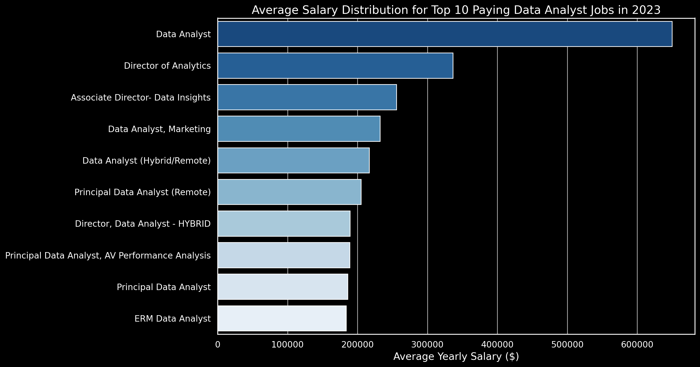

# Introduction
📊 Dive into the data job market! Focusing on data analyst roles, this project explores 💰 top-paying jobs, 🔥 in-demand skills, and 📈 where high demand meets high salary in data analytics. Check them out here: [project_sql folder](/project_sql) 
# Background
Driven by a quest to navigate the data analyst job market more effectively, this project was born from a desire to pinpoint top-paying and in-demand skills, streamlining others' work to find optimal jobs.

data hails from my [SQL Course](/https://lukebarousse.com/sql). It's packed with insights on job titles, salaries, locations, and essential skills.

### the question i wanted to answer through my SQL queries were:
1. what are the top-paying data analyst jobs?
2. what skills are required for these top-paying jobs?
3. what skills are most in demand for data analysts?
4. which skills are associated with higher salaries?
5. what are the most optimal skills too learn?
# Tools i used
for my deepp dive into the data analyst job market, i harnessed the poor of several key tools:
-   SQL: the backbone of my analysis, allowing me to query the database and eneath critical insights.
- PostgreSQL: the chosen database managment system, ideal for handling the job posting data.
Visual Studio Code: My go-to fpr data base mangment and excuting SQL queries.
- Git & Github: Essential for version control and sharing my SQL scripts and analysis, ensuring collaboration and project tracking.
# The analysis
Each query for this project aimed at investigating specific aspects of the data analyst job market.
here's how i approached each question:
### 1. Top paying Data Analyst Jobs
to identify the highest-paying rol.es i filtered data analyst positions by average yearly salary and location, focusing on remote jobs. This query highlights the high-paying opportunities in the field.
``` sql
SELECT 
job_title_short,
job_id,
salary_year_avg,
job_postings_fact.company_id,
job_schedule_type,
job_location,
job_via,
job_work_from_home,
name as company_name,
job_posted_date
from job_postings_fact
LEFT JOIN company_dim ON company_dim.company_id = job_postings_fact.company_id

where job_postings_fact.job_location = 'Anywhere'and job_postings_fact.salary_year_avg is NOT NULL and job_postings_fact.job_title_short = 'Data Analyst'

order by salary_year_avg DESC
limit 10 ; 
```
Here's the breakdown of the top paying data analyst jobs in 2023:
- **wide salary range** top 10 paying data analyst roles span from $184.000 to $650.000, indicating significant salary potential in the field.
- **diverse employers** companies like smartAssest, meta, and AT&T are among those offering high salaries, showing a broad interest across different industries.
- **job title variety** there's a high diversity in job titles, from Data Analyst to Director of Analytics, reflecting varied roles and specializationswithin data analytics. 

 
*Bar graph visualising the slalary for the top 10 salaries for data analysts; chatgpt generated this graph from my sql query results*

2. Skills for Top Paying Jobs

To understand what skills are required for the top-paying jobs, I joined the job postings with the skills data, providing insights into what employers value for high-compensation roles.

```
WITH top_paying_jobs AS (
    SELECT	
        job_id,
        job_title,
        salary_year_avg,
        name AS company_name
    FROM
        job_postings_fact
    LEFT JOIN company_dim ON job_postings_fact.company_id = company_dim.company_id
    WHERE
        job_title_short = 'Data Analyst' AND 
        job_location = 'Anywhere' AND 
        salary_year_avg IS NOT NULL
    ORDER BY
        salary_year_avg DESC
    LIMIT 10
)

SELECT 
    top_paying_jobs.*,
    skills
FROM top_paying_jobs
INNER JOIN skills_job_dim ON top_paying_jobs.job_id = skills_job_dim.job_id
INNER JOIN skills_dim ON skills_job_dim.skill_id = skills_dim.skill_id
ORDER BY
    salary_year_avg DESC;
```

*Bar graph visualizing the count of skills for the top 10 paying jobs for data analysts; ChatGPT generated this graph from my SQL query results*

3. ## In-Demand Skills for Data Analysts
This query helped identify the skills most frequently requested in job postings, directing focus to areas with high demand.

```
SELECT 
    skills,
    COUNT(skills_job_dim.job_id) AS demand_count
FROM job_postings_fact
INNER JOIN skills_job_dim ON job_postings_fact.job_id = skills_job_dim.job_id
INNER JOIN skills_dim ON skills_job_dim.skill_id = skills_dim.skill_id
WHERE
    job_title_short = 'Data Analyst' 
    AND job_work_from_home = True 
GROUP BY
    skills
ORDER BY
    demand_count DESC
LIMIT 5;
```
Here's the breakdown of the most demanded skills for data analysts in 2023:

SQL and Excel remain fundamental, emphasizing the need for strong foundational skills in data processing and spreadsheet manipulation.
Programming and Visualization Tools like Python, Tableau, and Power BI are essential, pointing towards the increasing importance of technical skills in data storytelling and decision support.


*Table of the demand for the top 5 skills in data analyst job postings*

4. ### Highest-Paying Skills

Exploring the average salaries associated with different skills revealed which skills are the highest paying.

```
SELECT 
    skills,
    ROUND(AVG(salary_year_avg), 0) AS avg_salary
FROM job_postings_fact
INNER JOIN skills_job_dim ON job_postings_fact.job_id = skills_job_dim.job_id
INNER JOIN skills_dim ON skills_job_dim.skill_id = skills_dim.skill_id
WHERE
    job_title_short = 'Data Analyst'
    AND salary_year_avg IS NOT NULL
    AND job_work_from_home = True 
GROUP BY
    skills
ORDER BY
    avg_salary DESC
LIMIT 25;
```
Here's a breakdown of the results for top paying skills for Data Analysts:

●**High Demand for Big Data & ML Skills:** The highest salaries are earned by analysts skilled in big data technologies (PySpark, Couchbase), machine learning tools (DataRobot, Jupyter), and Python libraries (Pandas, NumPy), reflecting the industry's high valuation of data processing and predictive modeling capabilities.
●**Software Development & Deployment Proficiency:** Knowledge in development and deployment tools (GitLab, Kubernetes, Airflow) indicates a lucrative crossover between data analysis and engineering, with a premium on skills that facilitate automation and efficient data pipeline management.
● **Cloud Computing Expertise:** Familiarity with cloud and data engineering tools (Elasticsearch, Databricks, GCP) underscores the growing importance of cloud-based analytics environments, suggesting that cloud proficiency significantly boosts earning potential in data analytics.


*Table of the average salary for the top 10 paying skills for data analysts*

5. ## Most Optimal Skills to Learn
Combining insights from demand and salary data, this query aimed to pinpoint skills that are both in high demand and have high salaries, offering a strategic focus for skill development.

```
SELECT 
    skills_dim.skill_id,
    skills_dim.skills,
    COUNT(skills_job_dim.job_id) AS demand_count,
    ROUND(AVG(job_postings_fact.salary_year_avg), 0) AS avg_salary
FROM job_postings_fact
INNER JOIN skills_job_dim ON job_postings_fact.job_id = skills_job_dim.job_id
INNER JOIN skills_dim ON skills_job_dim.skill_id = skills_dim.skill_id
WHERE
    job_title_short = 'Data Analyst'
    AND salary_year_avg IS NOT NULL
    AND job_work_from_home = True 
GROUP BY
    skills_dim.skill_id
HAVING
    COUNT(skills_job_dim.job_id) > 10
ORDER BY
    avg_salary DESC,
    demand_count DESC
LIMIT 25;
```
*Table of the most optimal skills for data analyst sorted by salary*

Here's the breakdown of the most demanded skills for the top 10 highest paying data analyst jobs in 2023:

SQL is leading with a bold count of 8.
Python follows closely with a bold count of 7.
Tableau is also highly sought after, with a bold count of 6. Other skills like R, Snowflake, Pandas, and Excel show varying degrees of demand.

# What i learned 
Thoughout this adventure i've turbocharged my SQL toolkit with some serious firepower:
- **complex query crafting** mastered the art of advanced sql, merginh tables like a pro and wielding WITH clauses for ninja-level temp table maneuvers.
- **Data Aggregation** got cozy with GROUP BY and turned aggregate functions like COUNT() and AVG() into my data-summarizing sidekicks.
- **Analytical Wizadry** leveled up my reak-world puzzle-solving skills, turning questions into actionable, insightful SQL queries.
# Conclusions
### Insights 
1. **Top-Paying Data Analyst Jobs**: the highest-paying jobs for data analysts that allow remote work offer a wide range of salaries, the highest at $650.000!
2. **skills for Top-Paying jobs**: high-paying data analyst jobs require advanced proficiency in SQL, suggesting it's crucial skill for earning a top salary.
3. **most in-demand skills**: SQL is also the most demanded skill in the data analyst job market, thus making it essential for a job seeker.
4. **skills with higher salaries**: specialized skills, such as SVN and solidity, are associated with the highest average salaries, indicating a premium on niche expertise.
5. **optimal skills for job market value**: SQL leads in demand and offers for a high average salary, positioning it as one of the most optimal skills for a data analysts to learn to maximize their value.

### closing thoughts
this project enhanced my SQL skills  and provided  valuable insights into the data analyst job market. the findings from the analysis serve as a guide to prioritizing skill development and job search efforts. aspiring data analysts can better position themselves in a competitive job market by focusing on high demand, high salary skills. this exploration highlights the importance of continous learning and adaptation to emerging trends in the field of data analytics. 
